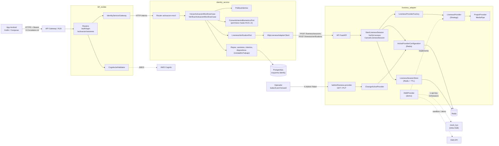
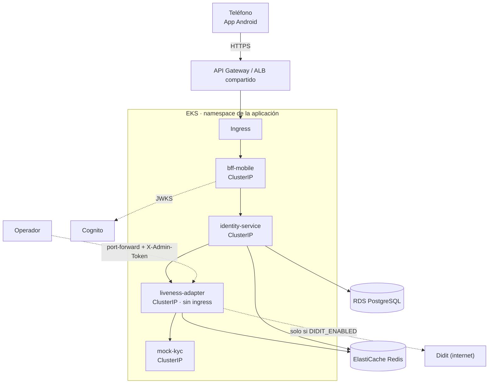
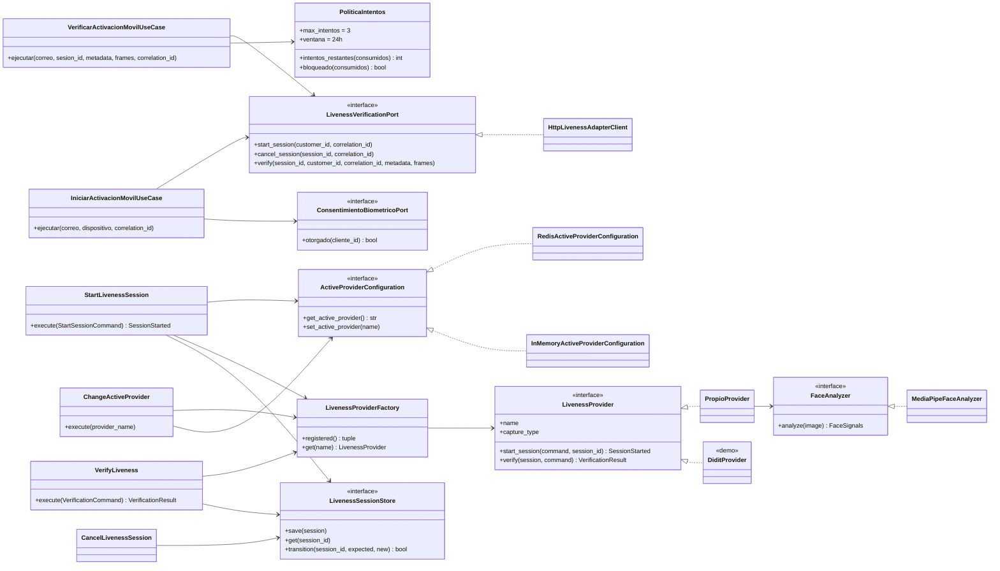
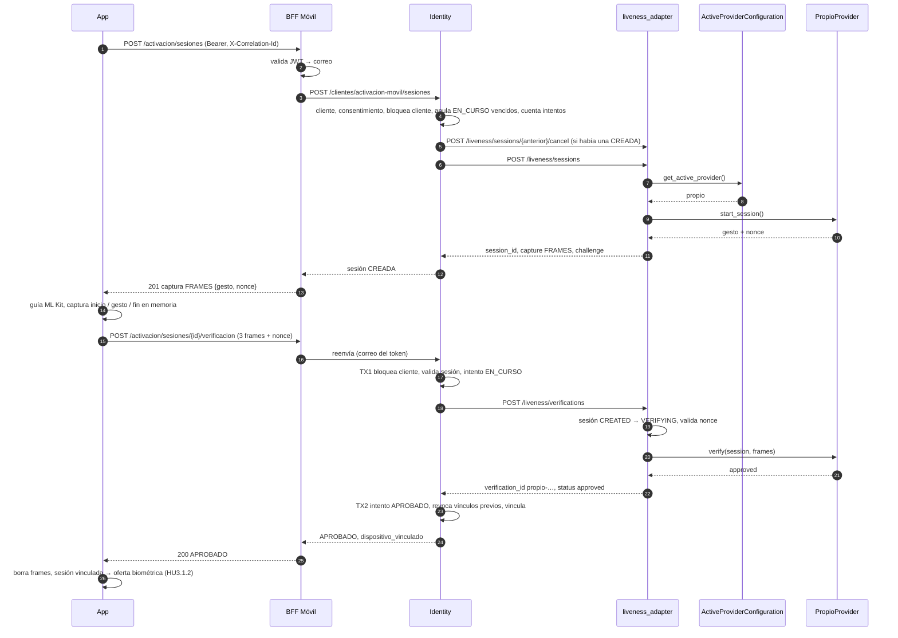
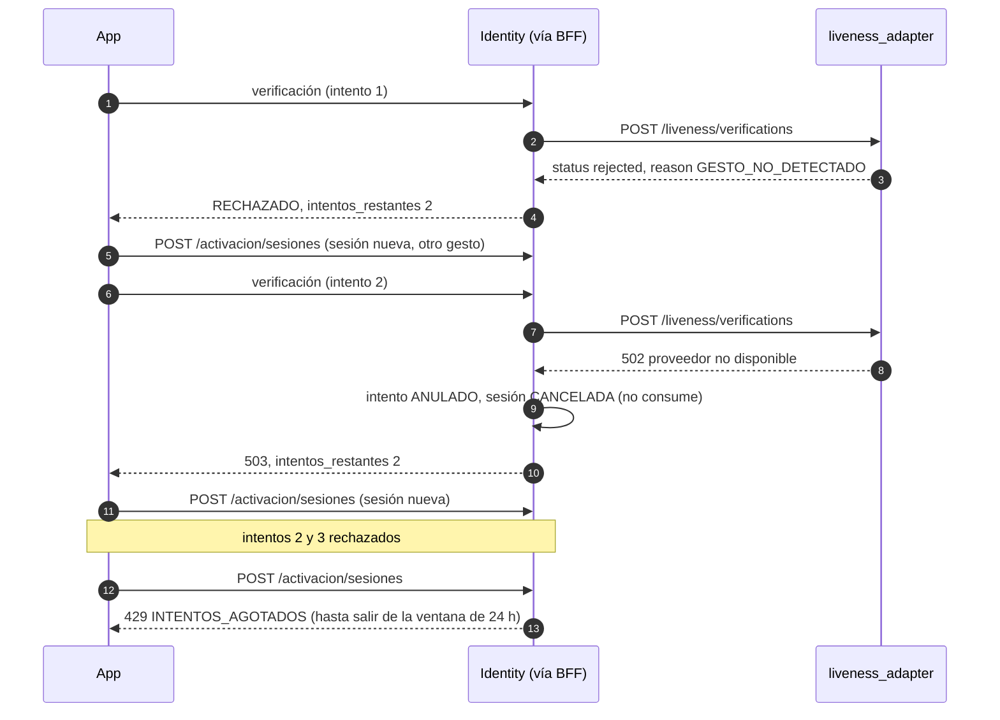
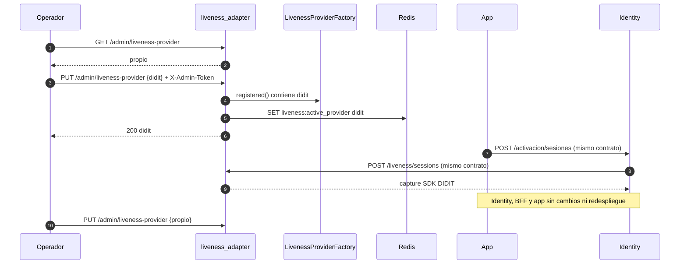
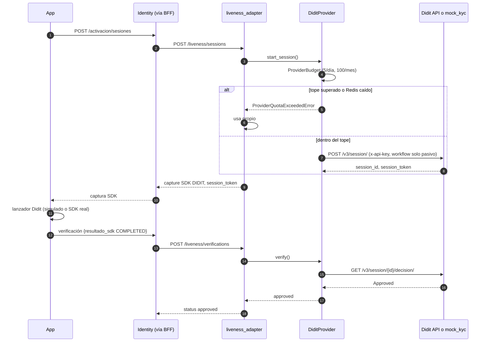
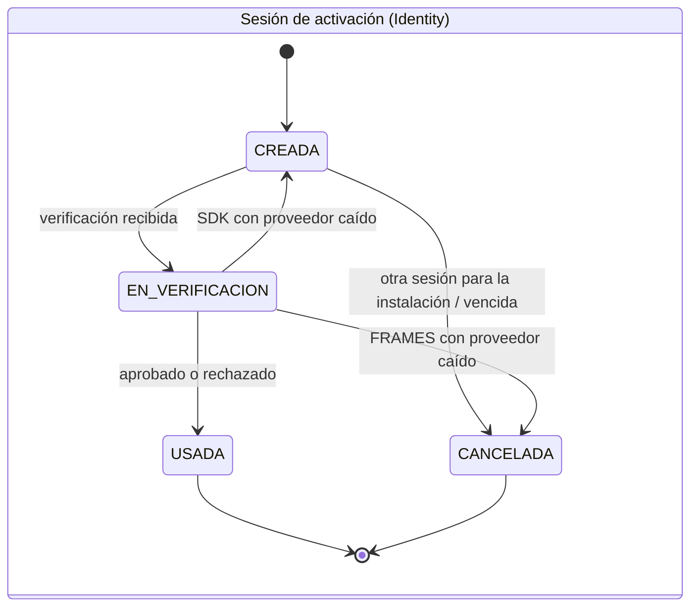
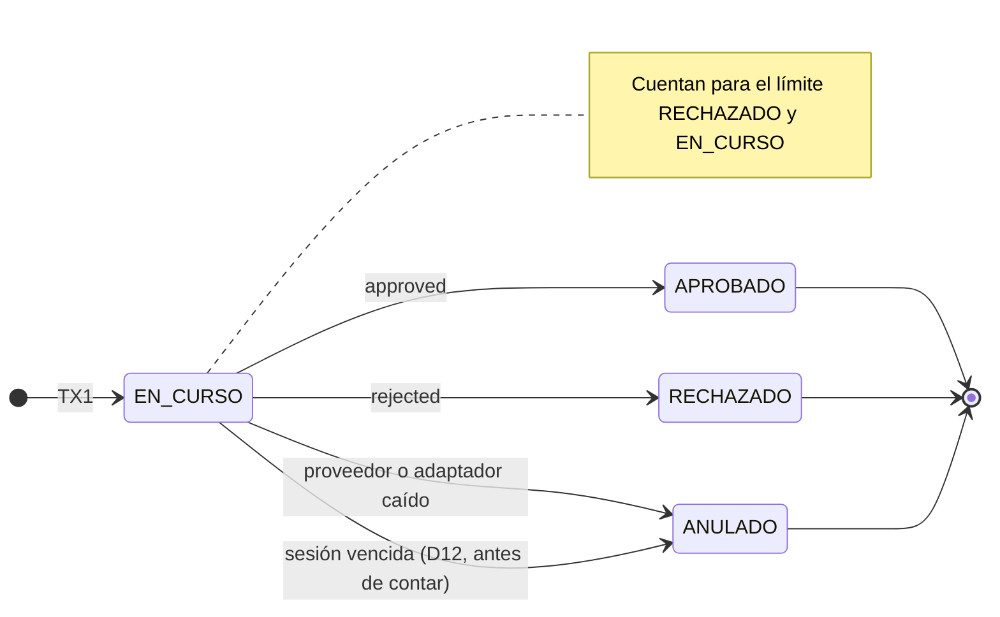
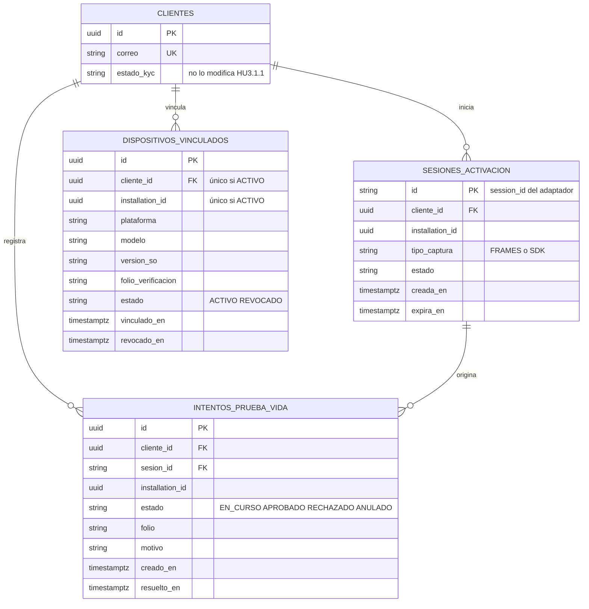

# HU3.1.1 · Arquitectura visual (backend)

Complementa [HU3.1.1-plan-tecnico.md](HU3.1.1-plan-tecnico.md). Mismo estilo y nombres que `../experimentos/docs/visual-architecture.md` (experimento HA12). La línea continua es lo que se construye primero (`propio`); lo punteado es Didit (demostración, desactivado por defecto, D9).

## 1. Componentes

**Lectura:** la dependencia de Identity termina en `LivenessVerificationPort`. Solo `liveness_adapter` conoce `PropioProvider`, `DiditProvider`, MediaPipe y la API de Didit. El proveedor activo se cambia por `/admin/liveness-provider` sin redesplegar.

## 2. Despliegue (dev / prod en AWS us-east-1)

| Servicio | Puerto local (compose) | Expuesto fuera del clúster |
|---|---:|---|
| identity_service | 8000 | No (solo vía BFF) |
| bff_web | 8001 | Sí |
| bff_mobile | 8002 | Sí |
| mock_kyc | 8202 | No |
| **liveness_adapter** | **8203** | **No** |

## 3. Clases y puertos

**Punto de extensión (HA12):** un proveedor nuevo implementa `LivenessProvider` y se registra en `LivenessProviderFactory`. No cambian los casos de uso, Identity, el BFF ni la app.

## 4. Secuencia: activación con captura `FRAMES` aprobada

## 5. Secuencia: rechazo, falla técnica y bloqueo

## 6. Secuencia: cambio dinámico de proveedor (evidencia del criterio de terminado)

## 7. Secuencia: captura `SDK` con Didit (demostración)

## 8. Estados

## 9. Modelo de datos (esquema `identity`)

El adaptador no tiene tablas: su estado técnico vive en Redis (`liveness:active_provider`, `liveness:session:<id>` con TTL, contadores `liveness:didit:sessions:*`).
